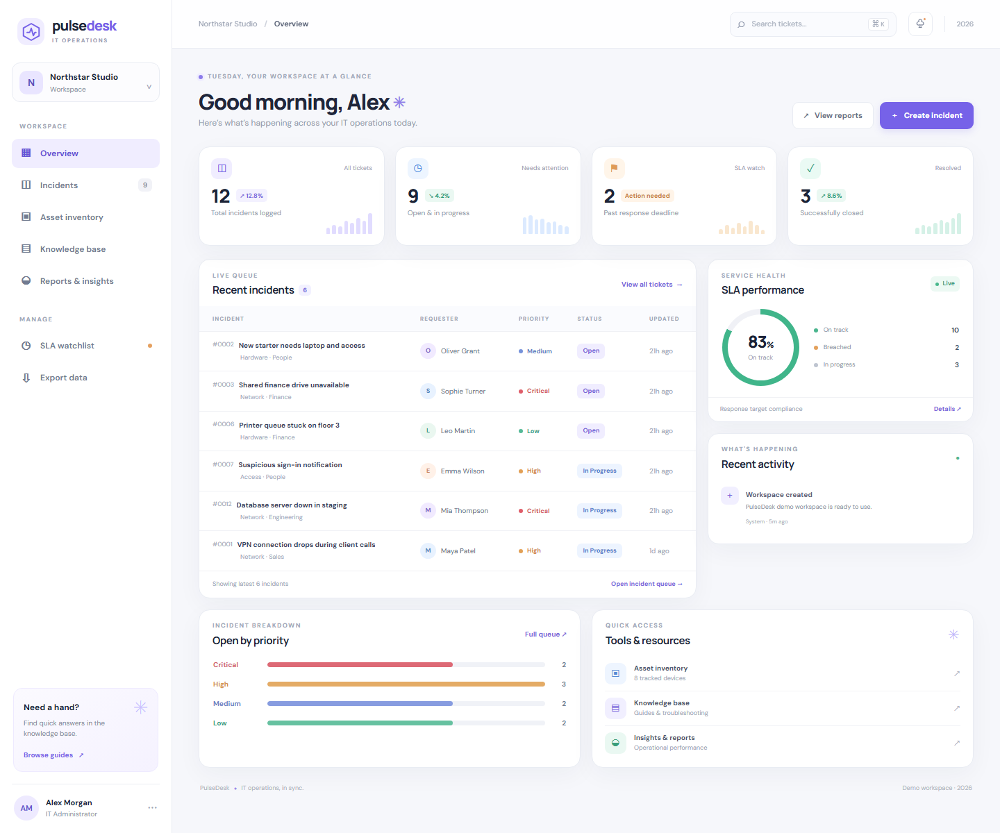

# PulseDesk

**An IT Operations & Service Desk Management Platform** built with Python, Flask, SQLite, HTML, CSS and JavaScript.

PulseDesk is a portfolio project that demonstrates practical IT operations workflows in a responsive, self-contained web application. The included Northstar Studio workspace is populated with fictional sample data so the product is useful immediately after setup.



## Product capabilities

- **Incident management:** create, search and filter incidents; assign owners; manage priorities and workflow status.
- **Rule-based smart triage:** suggest a priority and response target from incident keywords and category.
- **SLA monitoring:** compare ticket due times with current status and surface overdue work.
- **Asset inventory:** register devices, assign them to departments and users, and track stock/repair states and warranty dates.
- **Knowledge base:** searchable troubleshooting guides with view counts and a ticket hand-off.
- **Analytics & reporting:** workload by status, severity and category, resolution rate and SLA health.
- **Data export:** download the incident register as an Excel-friendly UTF-8 CSV.
- **Activity trail:** record incident and asset changes with an actor and timestamp.
- **REST endpoint:** expose key service-desk metrics as JSON at `/api/metrics`.

## Screens

| Screen | Purpose |
|---|---|
| Overview | Operational KPIs, live queue, SLA health and recent activity |
| Incidents | Searchable ticket queue and incident details/workflow |
| Asset inventory | Device register with ownership and lifecycle states |
| Knowledge base | Searchable internal support and troubleshooting articles |
| Reports & insights | Service desk health and workload breakdowns |

## Run locally

Requires Python 3.10 or newer.

```powershell
# 1. Create and activate a virtual environment
py -m venv .venv
.\.venv\Scripts\Activate.ps1

# 2. Install dependencies
py -m pip install -r requirements.txt

# 3. Start PulseDesk
py app.py
```

Open **http://127.0.0.1:5000**. On first launch, the app creates a local SQLite database and seeds fictional demo records.

## Run the test suite

```powershell
py -m unittest discover -s tests -v
```

The tests use isolated temporary databases; they do not alter your everyday demo workspace.

## Project structure

```
pulsedesk/
├── app.py                  # Flask routes, service logic and database setup
├── instance/               # Local SQLite database and generated secret (ignored)
├── static/
│   ├── app.js              # Modal, navigation and interaction behaviour
│   └── style.css           # Responsive product UI
├── templates/              # Jinja screens and reusable layout
├── tests/
│   └── test_app.py         # Automated integration tests
├── .gitignore
├── requirements.txt
└── README.md
```

## Engineering notes

- SQLite queries use parameter binding for user-supplied values.
- The app uses a local, persistent random Flask session secret rather than a hard-coded key.
- The knowledge article renderer escapes source text before adding a small, controlled set of HTML tags.
- The demo uses synthetic names and sample records only; do not enter real employee, company or incident data.
- Smart triage is transparent, rule-based assistance—not a trained AI model or a substitute for human impact assessment.
- Authentication, production deployment, file attachments, email notifications and configurable SLA policy are intentionally outside this first portfolio release.

## Suggested next iterations

1. Add role-based authentication and an audit log with field-level history.
2. Add configurable SLA calendars, escalation rules and notifications.
3. Add automated API tests, CI workflow and deployment configuration.
4. Add screenshots and a short product walkthrough to the portfolio.

## Licence

MIT — see [LICENSE](LICENSE).
