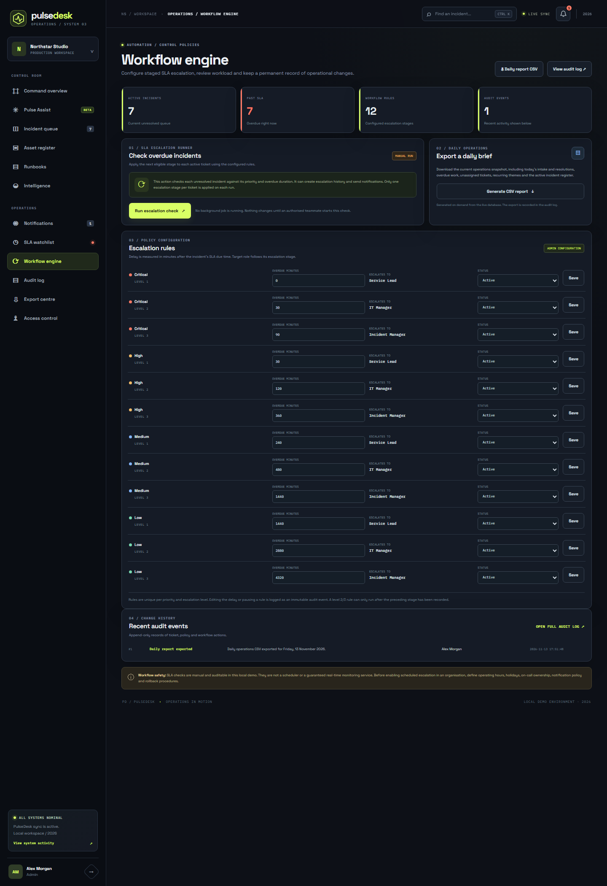

# PulseDesk

**An IT Operations & Service Desk Management Platform** built with Python, Flask, SQLite, HTML, CSS and JavaScript.

PulseDesk is a portfolio project demonstrating how an IT team can manage incidents, people, company assets, service levels and escalation workflows in one responsive workspace. The Northstar Studio demo environment is seeded with fictional records so the app is ready to explore after setup.





[View the new sign-in design](docs/pulsedesk-login-preview.png)

## Product capabilities

- **Role-based access:** secure sign-in with Admin, IT Agent and Employee roles.
- **Account administration:** Admins can create team accounts and assign roles; passwords are stored as Werkzeug password hashes.
- **Incident management:** create, search, filter, assign, prioritise and update requests.
- **Employee self-service:** employees can submit requests and view only requests they created.
- **Escalation workflow:** escalate active incidents through Service Lead, IT Manager and Incident Manager levels, with a timestamped reason and actor history.
- **Rule-based smart triage:** suggest priority and response targets from incident keywords and category.
- **SLA monitoring:** identify overdue incidents and surface an SLA watchlist.
- **Asset inventory:** register devices, track assignment, department, repair state and warranty.
- **Knowledge base:** searchable IT help articles and troubleshooting guides.
- **Analytics & reporting:** explore live incident intake/resolution trends, priority mix, current backlog, SLA compliance and team workload/performance.
- **Reporting windows:** filter trends to 7-day or 30-day daily buckets, 90-day weekly buckets, or a 12-month monthly view.
- **Team performance:** compare assigned volume, active workload, resolved incidents, overdue items and average resolution hours by current assignee.
- **CSV exports:** download the incident register or a period-specific analytics report in Excel-friendly UTF-8 format.
- **REST endpoints:** access operational metrics at `/api/metrics` and windowed reporting data at `/api/analytics?days=30`.
- **CSRF protection:** validate tokens on state-changing form submissions.
- **Notification centre:** personal in-app inbox, unread counts, read state and a compact notification popover.
- **Email alerts:** SMTP delivery for new requests, incident status changes and escalations; delivery outcomes are recorded in an admin-visible outbox.
- **Live updates:** protected polling API refreshes activity, notification counts, SLA metrics and visible incident rows every eight seconds.
- **Distinctive operations UI:** a dark control-room interface with live telemetry, signal stream and responsive layouts.
- **Pulse Assist:** explainable incident analysis with priority recommendations, detected impact signals and category-specific investigation checklists.
- **Knowledge matching:** rank existing runbooks using keyword overlap across article titles, summaries and content, with a small category-match boost.
- **Recurring incident radar:** group tickets from a rolling 90-day window into visible keyword themes and link back to the source incidents.
- **Daily operations brief:** calculate today's created/resolved volume, current active/critical/overdue/unassigned workload, recurring themes and recent activity.
- **Assistant API:** role-protected JSON endpoints for incident analysis, daily summary and recurring patterns.
- **Smart assignment:** rank active Admin and IT Agent accounts using their weighted active, critical and overdue workload; a human confirms the final assignment.
- **SLA workflow engine:** configure three-stage escalation delays per priority and manually process the next eligible stage for overdue incidents.
- **Immutable audit log:** append structured ticket, assignment, escalation, workflow-policy and report-export events; SQLite triggers reject updates and deletes.
- **Daily operations export:** generate a live CSV snapshot with daily intake/resolution, current risk counts, recurring themes and the active incident register.
- **Real-time worker health:** run the separate SLA worker with a single-instance lease, heartbeat, error reporting and configurable check interval.
- **Business-hours SLA clock:** calculate escalation delays using configurable local timezone, working days and daily operating hours; nights and weekends do not accumulate escalation minutes.
- **Monitoring & integrations:** view database health, scheduler status, worker heartbeat, SMTP configuration and delivery-outbox history from one protected screen.
- **SMTP test delivery:** Admins can send a test to their own signed-in address when SMTP is configured; otherwise a labelled preview is stored without sending.

## Analytics definitions

- **Incidents received** are records whose `created_at` timestamp falls inside the selected window. Trend buckets are daily (7/30 days), weekly (90 days) or monthly (12 months).
- **Resolved in period** uses the dedicated `resolved_at` timestamp. Reopening an incident clears it; resolving it again records a new timestamp. Existing resolved records are backfilled from their previous update timestamp during the additive migration.
- **Active and overdue** counts reflect the current register, not just tickets created inside the selected window. SLA compliance is measured against the active queue; resolved incidents are excluded from its denominator.
- **Team attribution** uses each incident's current assignee because this demo does not yet keep a reassignment history. “Assigned in period” counts tickets created in the selected window by their current assignee.
- **Average resolution hours** is calculated from `created_at` to `resolved_at` for incidents resolved during the window. It is shown only where at least one resolution sample exists.

## Pulse Assist rules and interpretation

Pulse Assist is intentionally a transparent local rules engine, not a trained language model or a third-party AI integration.

- Priority suggestions reuse the existing ticket triage rules and add explicit impact signals for service outages, broad impact, blocked work and possible security indicators.
- Investigation steps vary by category. Security-related phrases produce conservative guidance to avoid unexpected MFA approval, preserve alert details and follow the authorised incident-response process.
- Runbooks are ranked from the existing article table using keyword overlap: title matches carry the highest weight, followed by summary and article-content matches; an exact category match adds a small boost.
- Recurrence groups use a fixed keyword-theme dictionary over tickets created within the last 90 days. At least two tickets are required before a theme is shown. These are investigation leads, not proof of duplicate incidents or a shared root cause.
- The daily operations brief uses the computer's local date/time and current ticket records. It is a snapshot at page load, not a scheduled email report.
- Suggestions never update a ticket's priority or status automatically. An IT responder must validate impact, urgency and the recommended action.

## Workflow engine and audit trail

PulseDesk seeds 12 editable SLA rules: one for each priority at each of three escalation levels. Delays are measured in minutes after the ticket's due time.

| Priority | Level 1 · Service Lead | Level 2 · IT Manager | Level 3 · Incident Manager |
|---|---:|---:|---:|
| Critical | 0 min | 30 min | 90 min |
| High | 30 min | 120 min | 360 min |
| Medium | 240 min | 480 min | 1,440 min |
| Low | 1,440 min | 2,880 min | 4,320 min |

An Admin can edit the delay or pause any rule. Admins and IT Agents can explicitly run a manual SLA check. The runner skips tickets whose due time is in the future, applies only the next eligible stage per ticket on each run, records the escalation in the incident history, and sends normal in-app/email-outbox notifications.

### Scheduled worker and operating calendar

PulseDesk 7.0 adds `worker.py`, a separate process from the Flask web server. Scheduling is **disabled by default**. An Admin must configure the operating calendar and explicitly enable scheduled checks on **Monitoring**, then start the worker in a second PowerShell window from the project directory:

```powershell
py worker.py
```

The worker sends a heartbeat every 10 seconds, acquires a 35-second database lease to prevent duplicate instances, and checks the queue at the configured interval (30, 60, 120, 300 or 600 seconds). When the scheduler is paused, the worker remains online but makes no ticket changes. Stop it with Ctrl+C. A one-time worker cycle can be tested with `py worker.py --once`; it exits after a single pass.

The default calendar is **Europe/Riga, Monday–Friday, 09:00–17:00**. The post-deadline escalation clock counts business minutes only, excluding nights and unselected days. A threshold of zero means the first working minute after the SLA deadline; no escalation is triggered while zero working minutes have elapsed. The configured timezone should match the host machine's local timezone because existing ticket timestamps are stored as local wall-clock times. The calendar is weekly; public holidays and custom exception dates are not yet modelled.

The worker is opt-in and does not start automatically with Flask. If the worker is stopped or the computer sleeps, scheduled checks stop; the Monitoring screen shows a stale heartbeat as offline. A local development process is not a production service supervisor. A production deployment should run the worker under Task Scheduler, a Windows service or an equivalent process manager, with alerting on heartbeat expiry, timezone-aware business calendars, holiday schedules, on-call routing, backups and retry/idempotency monitoring.

The assignment scorer considers only active Admin/IT Agent accounts. Its transparent workload score is active × 3 + critical × 5 + overdue × 3; the lowest score is recommended first. It does not modify a ticket until a teammate confirms the selected assignee.

Audit events are append-only at the application/database level: SQLite triggers reject UPDATE and DELETE. Events include the actor, timestamp, entity, summary and structured metadata. This is not tamper-proof against someone with direct database-file/DDL access; production audit events should also be forwarded to protected central or tamper-evident storage.

## Useful endpoints

All operational routes below require an Admin or IT Agent session unless noted otherwise. State-changing POST routes require CSRF validation.

| Endpoint | Purpose |
|---|---|
| /assistant | Smart IT Assistant workspace |
| POST /api/assistant/analyze | Analyse a supplied incident JSON object |
| /api/assistant/summary | Today's operational summary |
| /api/assistant/recurrences?days=90 | Keyword-theme recurrence scan |
| /workflow | SLA workflow policy and manual runner |
| POST /workflow/run-sla | Manually check overdue incidents and apply next eligible stages |
| /monitoring | Worker health, SMTP delivery and business calendar |
| POST /monitoring/calendar | Admin-only calendar and scheduler settings |
| POST /monitoring/test-email | Admin-only SMTP test to the signed-in account |
| /api/monitoring/health | Protected JSON health snapshot |
| `worker.py` | Separate scheduled SLA worker process |
| /audit-log | Search the append-only event history |
| `/api/tickets/{id}/assignment-suggestions` | Ranked active IT account suggestions |
| /export/daily-operations.csv | Download a live daily operations brief |
| /api/analytics?days=30 | Windowed operational analytics |

## Demo accounts

On a fresh database, PulseDesk seeds three fictional accounts:

| Role | Email | Demo password |
|---|---|---|
| Admin | `admin@pulsedesk.demo` | `AdminDemo!2026` |
| IT Agent | `agent@pulsedesk.demo` | `AgentDemo!2026` |
| Employee | `employee@pulsedesk.demo` | `EmployeeDemo!2026` |

These credentials are intentionally predictable for a portfolio demonstration. **Do not use them for a real organisation or public deployment.** Change or remove the demo accounts before using real data.

## Role permissions

| Capability | Admin | IT Agent | Employee |
|---|:---:|:---:|:---:|
| View operational dashboard | ✓ | ✓ | — |
| Manage incidents | ✓ | ✓ | Own requests only |
| Escalate incidents | ✓ | ✓ | — |
| Manage company assets | ✓ | ✓ | — |
| View reports and export CSV | ✓ | ✓ | — |
| Search the knowledge base | ✓ | ✓ | ✓ |
| Create user accounts | ✓ | — | — |
| Use Pulse Assist and view daily IT brief | ✓ | ✓ | — |
| View assignment suggestions and confirm assignments | ✓ | ✓ | — |
| View workflow rules and run SLA check | ✓ | ✓ | — |
| Configure SLA workflow rules and business calendar | ✓ | — | — |
| Enable scheduled checks and test SMTP | ✓ | — | — |
| View worker health and SMTP outbox | ✓ | ✓ | — |
| View audit log and export daily brief | ✓ | ✓ | — |

## Escalation levels

| Level | Escalation target |
|---|---|
| 1 | Service Lead |
| 2 | IT Manager |
| 3 | Incident Manager |

Each escalation records the target level, reason, acting user and timestamp. Resolved incidents cannot be escalated, reasons are required, and the workflow stops at level 3.

## Run locally

Requires Python 3.10 or newer.

```powershell
# 1. Create and activate a virtual environment
py -m venv .venv
.\.venv\Scripts\Activate.ps1

# 2. Install dependencies
py -m pip install -r requirements.txt

# 3. Start PulseDesk in the first PowerShell window
py app.py
```

Open **http://127.0.0.1:5000** and sign in with the Admin account. Visit **Monitoring** to review the default Europe/Riga business calendar. Scheduling is off by default; enable it only when ready to let the worker process overdue tickets.

```powershell
# 4. In a second PowerShell window, from the same project directory:
py worker.py
```

The worker can remain open with scheduled checks paused, providing a heartbeat for the Monitoring screen. To enable actual automatic escalation, first enable the scheduler in the Admin-only Monitoring settings. Stop the worker with Ctrl+C. Use `py worker.py --once` for a one-cycle check.

### Configure real email delivery (optional)

Without SMTP settings, PulseDesk records clearly labelled email previews in the local outbox and does not send messages. To enable outbound alerts, set the following environment variables before starting the app:

```powershell
$env:PULSEDESK_SMTP_HOST = "smtp.your-provider.example"
$env:PULSEDESK_SMTP_PORT = "587"
$env:PULSEDESK_SMTP_FROM = "pulsedesk@your-domain.example"
$env:PULSEDESK_SMTP_USERNAME = "your-smtp-username"
$env:PULSEDESK_SMTP_PASSWORD = "your-smtp-app-password"
$env:PULSEDESK_SMTP_STARTTLS = "1"
py app.py
```

Use an SMTP app password or provider-issued credential, not your everyday email password. Keep credentials in environment variables or a secret manager; never commit them to Git. The Admin notification centre shows whether delivery is configured and records sent, preview and failed outcomes.

## Run the test suite

```powershell
py -m unittest discover -s tests -v
```

Each test uses an isolated temporary database for its test actions. Importing the app also runs the idempotent schema initialiser against the local demo database so any pending additive migrations are applied.

## Project structure

```
pulsedesk/
├── app.py                  # Flask routes, auth, permissions and data logic
├── instance/               # Local SQLite database and generated secret (ignored)
├── static/
│   ├── app.js              # Modal, navigation and live update behaviour
│   ├── analytics.js        # Interactive reporting charts
│   └── style.css           # Responsive product UI
├── templates/
│   ├── assistant.html      # Pulse Assist, daily brief and pattern radar
│   ├── workflow.html       # SLA policies, escalation runner and audit preview
│   ├── audit_log.html      # Searchable immutable event history
│   ├── monitoring.html     # Worker health, calendar and SMTP outbox
│   └── ...                 # Other Jinja screens and reusable layout
├── worker.py               # Opt-in scheduled SLA worker process
├── tests/
│   └── test_app.py         # Authentication and workflow integration tests
├── docs/
│   ├── pulsedesk-dashboard-preview.png
│   ├── pulsedesk-analytics-preview.png
│   ├── pulsedesk-workflow-preview.png
│   ├── pulsedesk-monitoring-preview.png
│   └── pulsedesk-login-preview.png
├── .gitignore
├── requirements.txt
└── README.md
```

## Engineering and security notes

- Existing PulseDesk databases receive additive schema migrations for ticket ownership, escalation history, resolution timestamps, workflow rules, audit events, the operating calendar and worker state; existing ticket and asset rows are retained.
- SQL statements use parameter binding for user-supplied values.
- Passwords are hashed with Werkzeug's password hashing helpers; plaintext passwords are never stored.
- Session cookies are HTTP-only and use SameSite=Lax. Set `PULSEDESK_SECURE_COOKIES=1` behind HTTPS to enable the Secure cookie flag. CSRF tokens are checked for POST requests.
- The knowledge article renderer escapes source text before emitting its controlled HTML subset.
- Demo records use fictional names. Do not enter real employee or incident information into this demo.
- Smart triage and Pulse Assist use transparent keyword/category rules, not a trained AI model; all recommendations require human review.
- Knowledge matches, recurring themes and assignment rankings are heuristic decision-support signals, not semantic root-cause analysis or autonomous decisions.
- The scheduled worker is opt-in and separate from Flask; it performs no scheduled ticket changes until an Admin enables the scheduler and starts `worker.py`.
- Business-calendar timestamps use local wall-clock time, so the configured timezone should match the host machine's timezone. Public holidays and exception dates are not yet modelled.
- Audit events are append-only through database triggers, but direct access to the SQLite file is not tamper-proof storage.
- Email alerts are sent only when SMTP host and sender settings are present; otherwise the outbox records a preview rather than claiming delivery.
- The live dashboard uses authenticated eight-second HTTP polling, not a persistent WebSocket connection.

This is a local portfolio demonstration, not a production-ready identity or service-management system. A real deployment needs HTTPS, secure-cookie configuration, MFA, login rate-limiting and lockout controls, password reset procedures, monitored backups, a hardened production WSGI server, and an organisation-specific privacy and retention policy.

## Next iterations

1. Add holiday/exception calendars, on-call rotations and production process supervision.
2. Add reassignment history, richer user lifecycle controls and protected central audit forwarding.
3. Add CI, deployment configuration and browser-based end-to-end tests.

## Licence

MIT — see [LICENSE](LICENSE).
