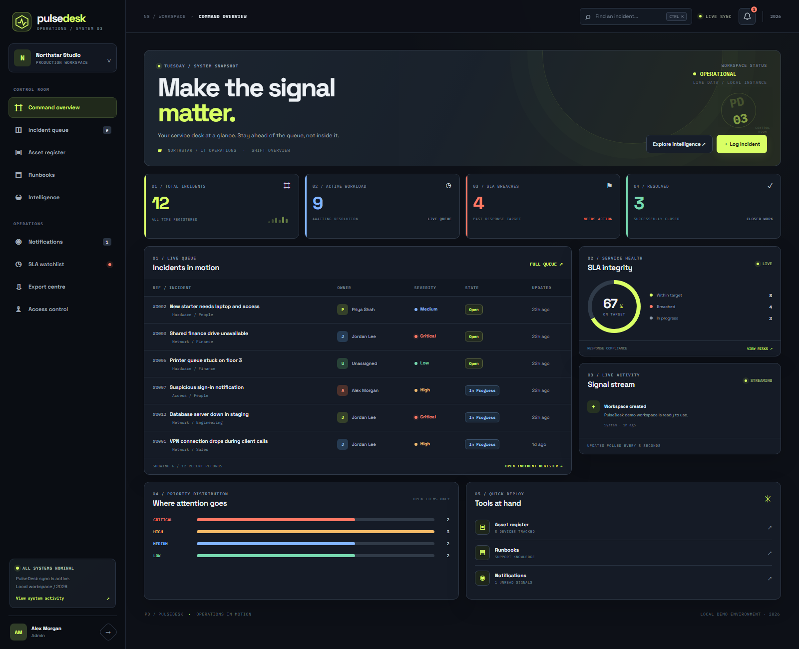
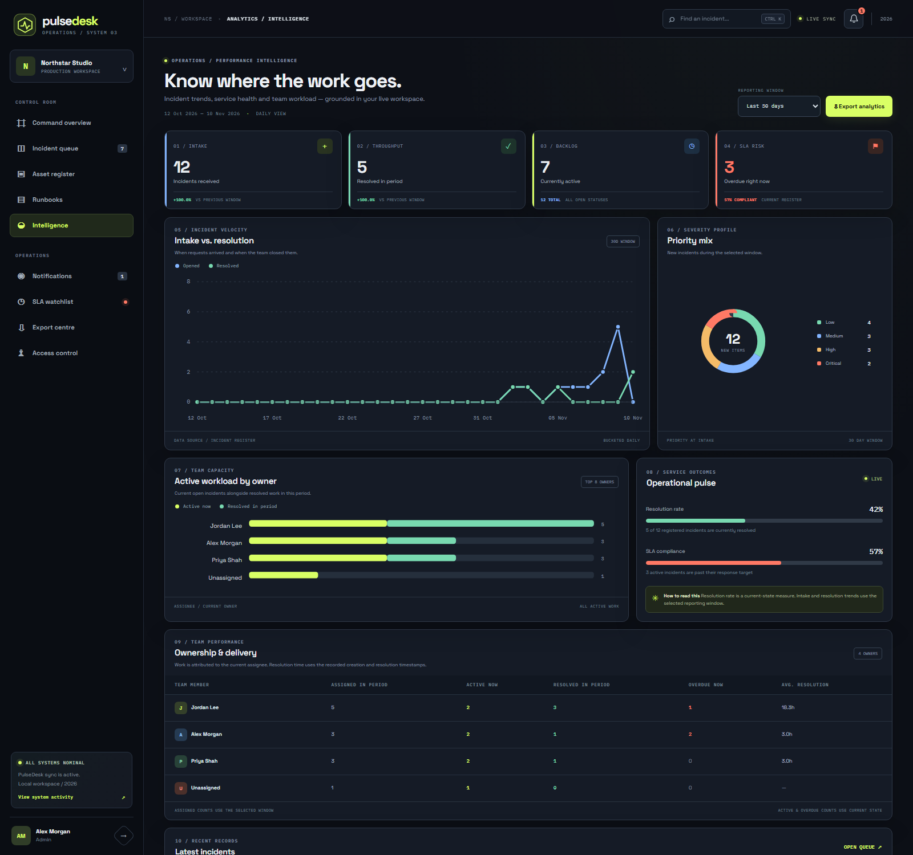
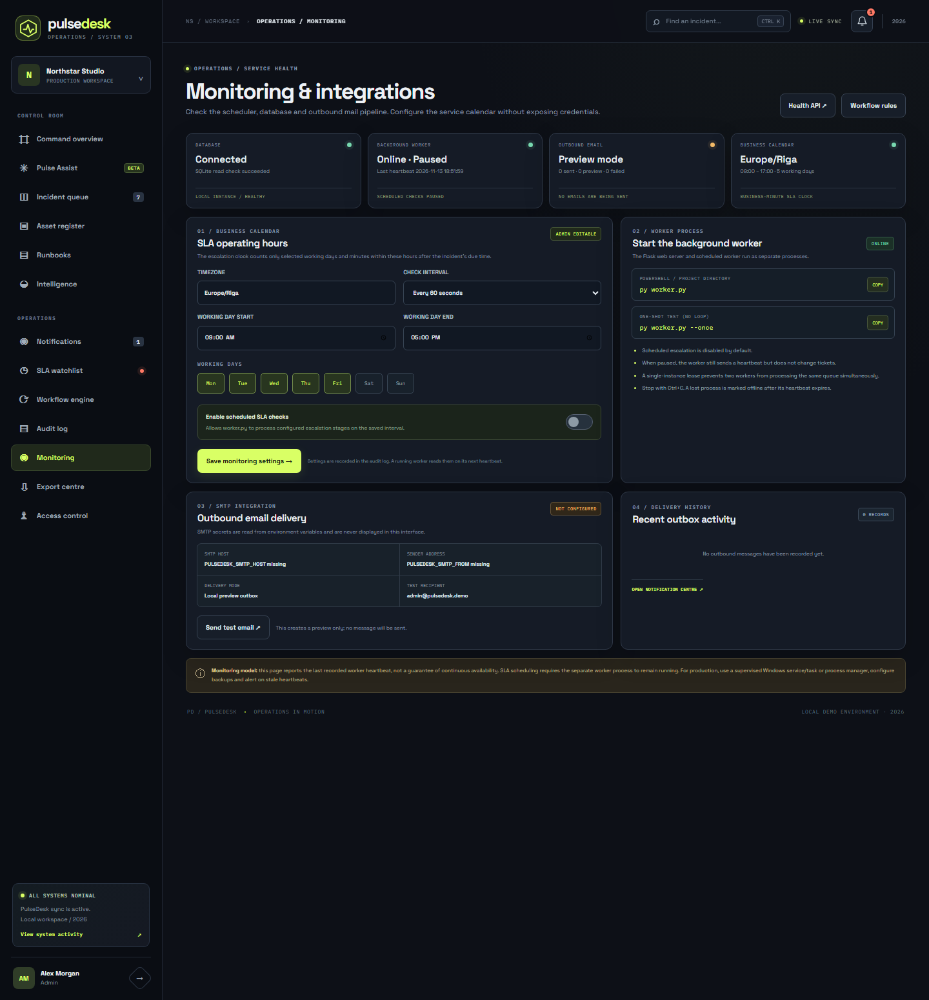
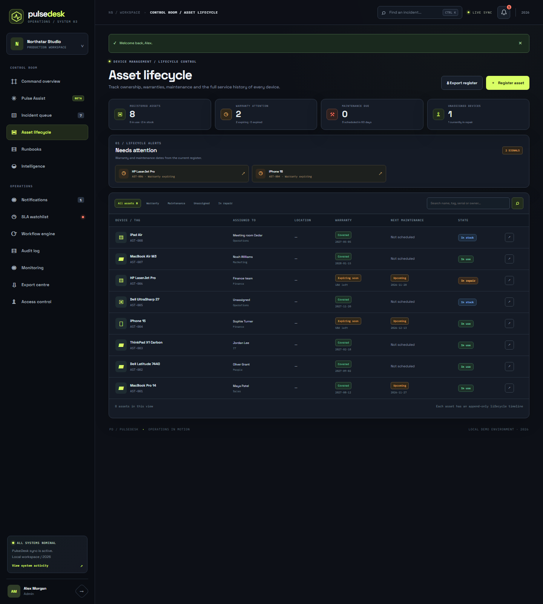
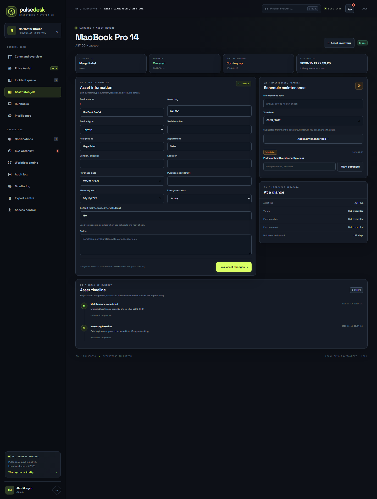

# PulseDesk

**A local IT operations and service-desk platform** built with Python, Flask, SQLite, JavaScript, HTML and CSS.

PulseDesk brings incident handling, service-level workflows, asset lifecycle management and operational reporting into one responsive workspace. I built it as a hands-on project to explore how software can make everyday IT operations clearer, more structured and easier to manage.



## At a glance

- **Incident management:** create, search, assign, prioritise and track support requests.
- **SLA workflows:** configurable escalation stages, business-hours calculations and an opt-in background worker.
- **Asset lifecycle:** inventory, warranty watchlists, scheduled maintenance and append-only asset timelines.
- **Operational insight:** interactive analytics, team workload views, CSV exports and protected JSON endpoints.
- **Pulse Assist:** an explainable, rule-based helper for incident triage, runbook matching and recurring-issue signals.
- **Accountability:** role-based access, CSRF protection and an append-only audit history.
- **Quality checks:** automated Python integration tests and GitHub Actions checks for Python and JavaScript.

## Interface previews

| Dashboard | Analytics |
|---|---|
|  |  |

| SLA workflow | Monitoring |
|---|---|
|  |  |

| Asset register | Asset detail |
|---|---|
|  |  |

[View the sign-in screen](docs/pulsedesk-login-preview.png)

## Technology

**Backend:** Python, Flask, SQLite  
**Frontend:** HTML, CSS, JavaScript, Jinja templates  
**Engineering:** role-based permissions, parameterised SQL, schema migrations, CSRF protection, automated tests, GitHub Actions CI

## Run locally

Requires Python 3.10 or newer.

```powershell
py -m venv .venv
.\.venv\Scripts\Activate.ps1
py -m pip install -r requirements.txt
py app.py
```

Open http://127.0.0.1:5000 and sign in with one of the fictional demo accounts:

| Role | Email | Password |
|---|---|---|
| Admin | `admin@pulsedesk.demo` | `AdminDemo!2026` |
| IT Agent | `agent@pulsedesk.demo` | `AgentDemo!2026` |
| Employee | `employee@pulsedesk.demo` | `EmployeeDemo!2026` |

These accounts are for local demonstration only. Do not use the credentials or demo database for real organisational data.

### Optional background worker

The SLA worker is separate from the Flask app and scheduling is disabled by default. To run a worker heartbeat, open a second terminal in the project directory:

```powershell
py worker.py
```

Enable scheduled checks from the Admin Monitoring settings only when you intend to test automated escalation. Stop the worker with Ctrl+C. A single test cycle can be run with `py worker.py --once`.

## Test suite

Run the integration tests with:

```powershell
py -m unittest discover -s tests -v
```

The GitHub Actions workflow compiles the Python modules, checks JavaScript syntax and runs the test suite on pushes and pull requests to `main`.

## Product decisions and limitations

Pulse Assist is a **transparent keyword- and rule-based decision-support feature**, not a trained AI model or third-party AI integration. It provides suggestions for a human to review; it does not autonomously change incident priority or status.

Email notifications are stored as clearly labelled previews when SMTP is not configured. The background worker is opt-in and depends on the host machine remaining available. The application currently uses a local SQLite database and Flask development server.

This is a portfolio demonstration, **not a production-ready service-management system**. A real deployment would require HTTPS, a hardened WSGI server, MFA, login rate limiting, password recovery, monitored backups, production process supervision and an organisation-specific security and data-retention review.

## Suggested walkthrough

1. Create or open an incident and review its triage recommendation.
2. Explore Pulse Assist and its related knowledge-base suggestions.
3. Inspect the SLA workflow matrix and audit history.
4. Change the analytics period and export a report.
5. Open an asset, schedule maintenance and inspect its event timeline.

Use fictional records only.

## Project structure

```
pulsedesk/
├── app.py
├── worker.py
├── static/                 # CSS and JavaScript
├── templates/              # Flask/Jinja interface
├── tests/                  # Integration tests
├── docs/                   # Interface screenshots
├── .github/workflows/      # CI quality checks
├── requirements.txt
└── README.md
```

## Licence

MIT — see [LICENSE](LICENSE).
